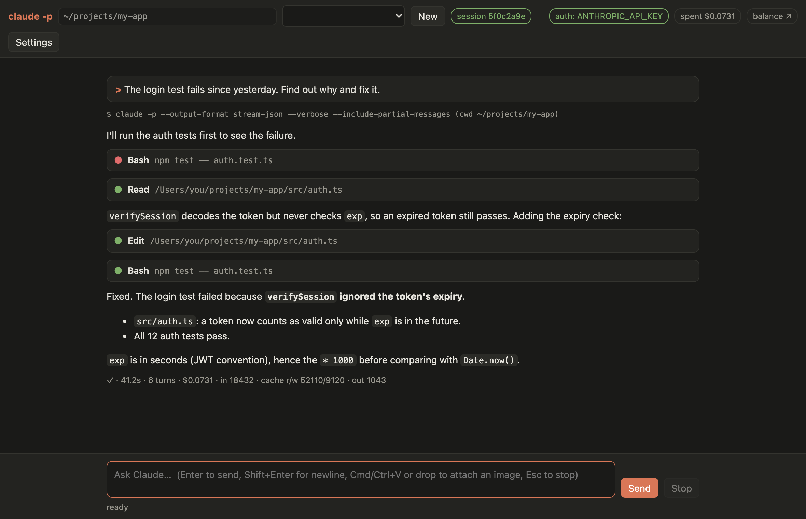

# claude-api-ui

A small local web UI for [Claude Code](https://code.claude.com) in headless mode (`claude -p`),
billed to your **Anthropic API key** (Console credits) instead of a Claude subscription.

It gives you a chat window in the browser that streams Claude's answers, tool calls and
results live, resumes earlier sessions, and shows what each prompt cost. It has no
dependencies: one Node.js script and one HTML page.



> Unofficial community project, not affiliated with or endorsed by Anthropic. Claude and
> Claude Code are trademarks of Anthropic, PBC.

## Requirements

- **Node.js 18+**
- **Claude Code** installed with `claude` on your `PATH`, or set `CLAUDE_BIN=/path/to/claude`.
- An **Anthropic API key** from the [Claude Console](https://platform.claude.com).
- macOS or Linux. Windows is untested.

## Install

```sh
npm install -g claude-api-ui
```

Or run it without installing: `npx claude-api-ui`.

From source:

```sh
git clone https://github.com/petertulala/claude-api-ui.git
cd claude-api-ui
npm link          # puts `claude-api-ui` on your PATH; or run `node cli.js`
```

## Set your API key

The app looks for `ANTHROPIC_API_KEY` in these places, in order:

1. The environment: `export ANTHROPIC_API_KEY=sk-ant-...`
2. The `env` section of `~/.claude/settings.json`, which Claude Code applies itself:
   ```json
   { "env": { "ANTHROPIC_API_KEY": "sk-ant-..." } }
   ```
3. A key file:
   ```sh
   mkdir -p ~/.config/claude-api-ui
   printf '%s' 'sk-ant-...' > ~/.config/claude-api-ui/api_key
   chmod 600 ~/.config/claude-api-ui/api_key
   ```

An `apiKeyHelper` in `~/.claude/settings.json` is accepted too.

## Run

Run it from the project directory you want Claude to work in:

```sh
cd ~/path/to/your/project
claude-api-ui
```

It prints a URL like `http://127.0.0.1:8765/?t=<token>` and opens it in your browser.

| Option         | Meaning                                                  |
| -------------- | -------------------------------------------------------- |
| `--cwd DIR`    | Default working directory (default: current directory)   |
| `--port N`     | Port to listen on (default 8765, or the next free port)  |
| `--no-browser` | Don't open the browser, just print the URL               |
| `--version`    | Print the version                                        |

## Using it

Each prompt runs:

    claude -p --output-format stream-json --verbose --include-partial-messages \
           --input-format stream-json \
           [--resume <session-id>] [--model …] [--effort …] [--permission-mode …] \
           [--allowedTools …] [--max-budget-usd …] [extra args]

with the prompt written to stdin as a stream-json user message (see Steering).

The exact command is shown above each answer.

**Keys:** Enter sends · Shift+Enter adds a newline · Esc stops the run (kills the whole process
group, including tools) · Cmd/Ctrl+K starts a new session.

### Sessions

- The first prompt starts a new session. Each later prompt resumes that session by ID
  (`--resume`), so other Claude sessions in the same directory don't interfere.
- The **sessions panel** on the left lists the sessions Claude Code has stored
  (`~/.claude/projects/`), grouped by folder. That includes sessions started in a terminal or
  in other Claude Code apps. The current folder comes first, then your other folders, most
  recently used first. Click a session to show its history and continue it. A session from
  another folder switches the working directory to that folder. Folders that no longer exist
  are left out. **☰** in the top bar hides or shows the panel.
- The **working directory** belongs to the session and is locked once it starts. To start
  somewhere else, click **+** next to a folder in the panel. Or click **+ New session** and type
  a path; the path box suggests your recent folders.
- Settings: **--continue when new** uses `--continue` for the first prompt;
  **fork on resume** adds `--fork-session`.

### Billing and cost

- The **auth** badge shows the `apiKeySource` Claude reports when each run starts. Green
  `ANTHROPIC_API_KEY` means the run is billed to your API key.
- **Require API key** (Settings, on by default) refuses to start without a key and stops any run
  that would be billed some other way, such as a logged-in subscription.
- **Max $/prompt** maps to `--max-budget-usd`.
- Each answer shows the cost of that prompt alone. When `claude` resumes the session it saved
  last, it restores that session's cost (`lastCost` in `~/.claude.json`), so `total_cost_usd`
  becomes the session total. The server subtracts what was saved before the run. The session
  total is shown in brackets.
- The **spent** badge adds up the cost of the prompts run in the current browser tab. It is not
  your account balance; the API doesn't expose that, so **balance ↗** links to the Console
  billing page.

### Permissions

`claude -p` can't ask for approval, so any tool that isn't pre-approved is **denied**, and the
result line lists the denied tools. Allow them under Settings with **Allowed tools**
(e.g. `Bash(git *) Edit`) or a **Permissions** mode (`acceptEdits`, `auto`,
`bypassPermissions`), then ask again.

### Images

Paste an image into the prompt box with **Cmd+V / Ctrl+V**, or drop image files on it. Each
one shows as a thumbnail with a × to remove it. If the clipboard also holds text (e.g. cells
copied from a spreadsheet), the text is pasted instead. Images whose longer side exceeds
1568 px are scaled down first; the API would shrink them anyway, and smaller images cost fewer
input tokens. PNG, JPEG, GIF and WebP are accepted, up to 20 per prompt.

Images go into the user message as image blocks. Images in a resumed session's history are
shown too.

### Steering

You can type while Claude is working, as in interactive Claude Code. Enter writes the message
into the running `claude`, and the chat marks it "sent while Claude was working".

How it works: every prompt is sent as a stream-json user message (`--input-format stream-json`),
and `claude`'s stdin stays open while the turn runs, so further messages can be written into it.
When the turn's `result` arrives, the server closes stdin so `claude` can exit. Anything already
written is still handled before that.

- **Too late for the turn:** a message sent after the turn finished, while `claude` is still
  shutting down, is queued and sent as the next prompt (resuming the session) as soon as the
  run ends.
- **Stop (Esc):** queued messages are not run; they go back into the prompt box.

### Browser

**Browser** (Settings) gives Claude a web browser. The chosen browser's tools are
pre-allowed, because `-p` can't ask for approval.

| Option | What Claude uses | Your logins | Billing |
| ------ | ---------------- | ----------- | ------- |
| **Your Chrome (Playwright extension)** | your running Chrome, in new tabs | yes | API key |
| **Your Brave (Playwright extension)** | your running Brave, in new tabs | yes | API key |
| **Playwright MCP** (visible / headless) | a separate browser with its own profile, kept while the app runs | no | API key |
| **Claude in Chrome** | your Chrome, via the Claude in Chrome extension | yes | claude.ai account only (see below) |

#### Use your own browser (Chrome or Brave)

This lets Claude open pages in your everyday browser, with your profile and logins. It uses
[Playwright MCP](https://github.com/microsoft/playwright-mcp) in extension mode
(`@playwright/mcp --extension`), started with `npx`. One-time setup:

1. **Install the Playwright extension** from the
   [Chrome Web Store](https://chromewebstore.google.com/detail/playwright-extension/mmlmfjhmonkocbjadbfplnigmagldckm).
   Install it in the browser and profile you want Claude to use; it works in Brave too.
2. **Save the extension token,** so you don't have to approve every connection. Click the
   extension's icon and copy the value of `PLAYWRIGHT_MCP_EXTENSION_TOKEN`. Then add it to the
   `env` section of `~/.claude/settings.json`; `claude` passes it on to Playwright:
   ```json
   { "env": { "PLAYWRIGHT_MCP_EXTENSION_TOKEN": "…" } }
   ```
   Don't put it in **Extra args**, which is shown in the command line above each answer.
3. **macOS: allow access to browser data.** Playwright reads your browser's profile folder to
   find the extension, and macOS blocks that for Terminal apps by default (`Operation not
   permitted`, or "Playwright Extension not found"). Open **System Settings → Privacy &
   Security → Full Disk Access**, turn on the terminal app you start `claude-api-ui` from, then
   quit and reopen it. Full Disk Access is broad, so turn it off again if you stop using this.
4. **Restart `claude-api-ui`** and choose **Settings → Browser → Your Chrome** or **Your Brave**.
   It must match the browser where you installed the extension.

Then keep that browser open and ask, for example, "Open https://example.com in a new tab
and tell me the title." The first time, the extension opens its **Welcome** tab to connect.
With the token saved it connects without asking, and you can close that tab. Without the
token, click the button on the Welcome page to allow the connection; until you do, Claude's
browser calls wait.

The connection stays open between prompts. The app runs one Playwright MCP server per Browser
option (`@playwright/mcp --port … --shared-browser-context`), started on first use and kept
until you quit `claude-api-ui`. Each `claude` run connects to it over local HTTP instead of
starting its own. Playwright closes the browser connection when its last client disconnects,
which would otherwise happen whenever a prompt finishes. So the app stays connected to that
server as an idle client of its own. Follow-up prompts and other sessions therefore keep the
same browser connection and tabs, and the Welcome tab appears once per app start, not per
prompt. If the browser goes away (for example, you quit it), the next prompt reconnects. The app passes on the `env` of `~/.claude/settings.json` (such as the extension token) to
that server, without your Anthropic key.

Brave: Playwright officially supports only Chrome and Edge. The Brave option points Playwright
at the Brave binary (`PLAYWRIGHT_MCP_EXECUTABLE_PATH`), and it works with Brave on macOS.

#### Claude in Chrome

**Claude in Chrome** passes `--chrome`, so Claude Code uses its own Claude in Chrome extension.
Claude Code enables it only for sessions on a claude.ai account, not for runs billed to an API
key, so it doesn't load in this app with an API key. The app then stops the run at startup.
Otherwise Claude would fall back to shell commands such as `open -na "Google Chrome"`, which can
open a second Chrome with an empty profile. Use **Your Chrome** instead.

#### Notes

- Page snapshots are saved in `.playwright-mcp/` in the working directory, and they contain
  page content. Add `.playwright-mcp/` to your projects' `.gitignore`.
- Screenshots and page snapshots count as input tokens, so browser-heavy prompts cost more.
  Use **Max $/prompt** to cap them.
- Claude acts in your real, logged-in browser. Only point it at sites and tasks you'd be happy
  for it to act on as you.

### Other settings

Model, effort, a raw-event view for debugging, and **Extra args** for any other `claude` flag.
Settings are kept in your browser's local storage.

## Security

- The server listens on `127.0.0.1` only.
- Every request needs a random token generated at each launch. It is part of the printed URL,
  so other web pages can't drive the app.
- It runs `claude` with your user's permissions in the chosen directory, with whatever tool
  permissions you allow. Don't expose the port to other machines.
- Your API key is never sent to the browser. The page only learns whether a key was found.

## License

[MIT](LICENSE)
